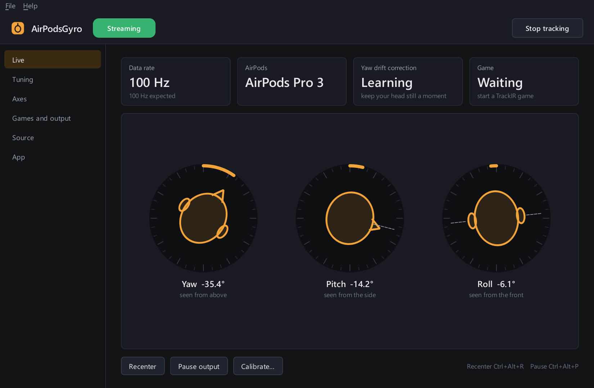
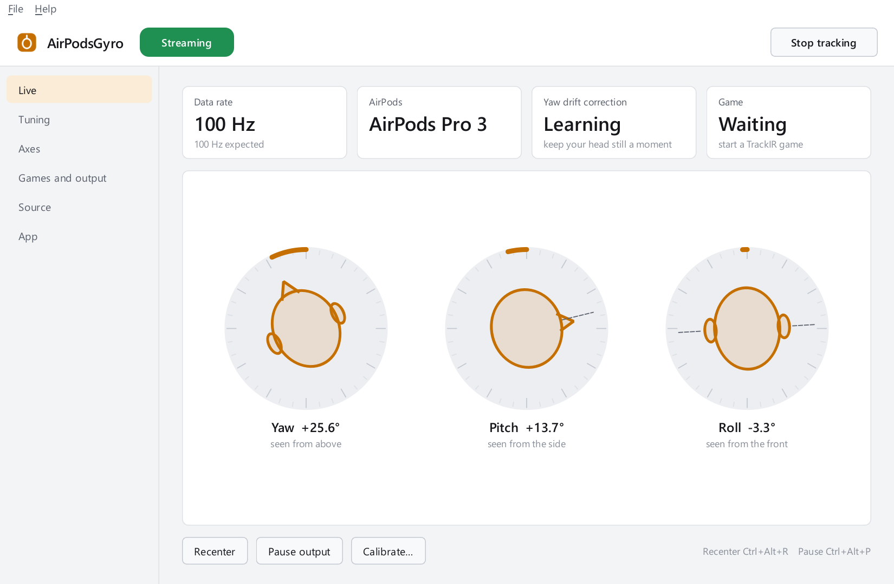
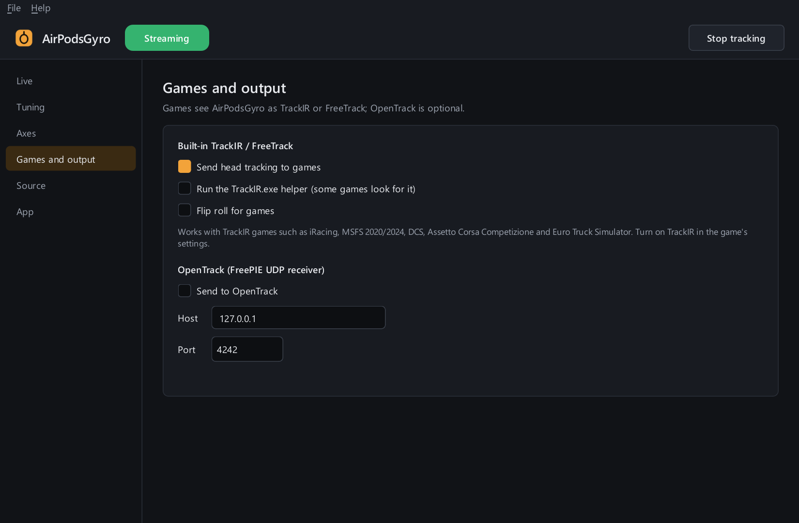
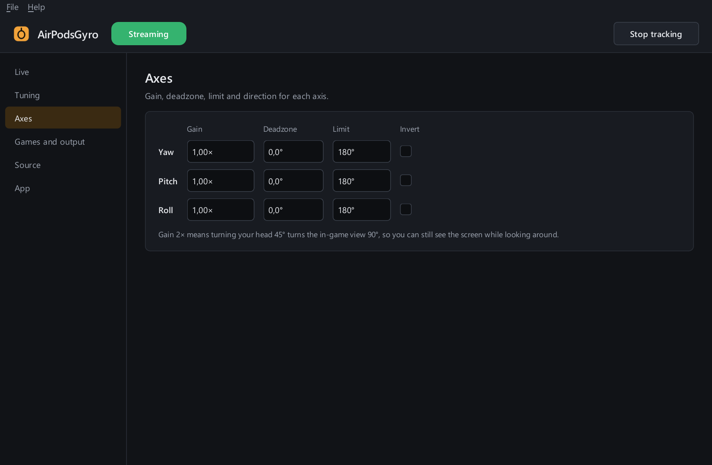
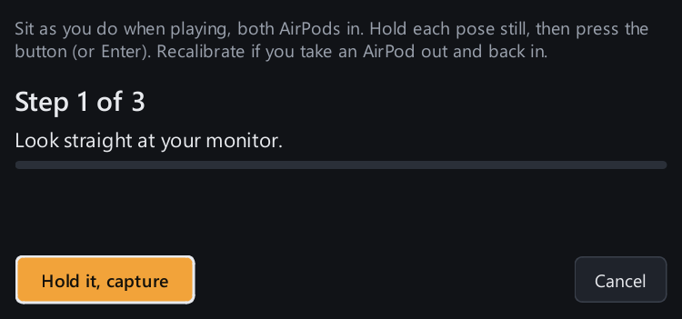

# AirPodsGyro

Use AirPods Pro 3 as a head tracker for racing and flight sims on a Windows PC, natively over the PC's own
Bluetooth, with no Raspberry Pi, phone or OpenTrack needed. The AirPods keep playing PC audio while they track.

**Status (2026-11-08):** works end to end, but **only with Windows test-signing mode on** (Secure Boot off).
That rules out games protected by Easy Anti-Cheat. See [Limiting factor](#limiting-factor).



## Screenshots

These are screenshots of the real app, not mockups. The head poses come from a recording of AirPods Pro 3 on
a real head.

| Light theme (follows Windows) | Games and output |
| --- | --- |
|  |  |

| Axes | Calibration (three held poses, about 20 seconds) |
| --- | --- |
|  |  |

To regenerate them: `.venv\Scripts\python airpodsgyro\tests\readme_shots.py`. This replays
`tools/capture-20261107-224116` through the app.

## What has been done

| Part | Where | State |
| --- | --- | --- |
| Linux check: Pro 3 streams head tracking over BlueZ | `tools/ubuntu-pro3-check.sh`, `tools/soak-*` | passed, ~100 Hz |
| Core: AirPods protocol, session (reconnect, clean stop), head-angle math, smoothing | `airpodsgyro/core/` | done, unit-tested |
| Yaw-drift correction (the AirPods' heading drifts 1–5°/min) | `airpodsgyro/core/drift.py` | residual drift < 0.2°/min on recordings |
| Game output: built-in TrackIR / FreeTrack (opentrack's client DLLs), optional OpenTrack UDP | `airpodsgyro/outputs/` | verified by reading back through `NPClient64.dll` |
| Desktop app: status, live head view, calibration wizard, settings, tray, in-game hotkeys | `airpodsgyro/app.py`, `airpodsgyro/gui/` | done |
| Packaged app: `AirPodsGyro.exe` (self-tests itself at build time) | `airpodsgyro/packaging/build.py` → `dist/` | done |
| Windows kernel driver: opens the AirPods' head-tracking channel (L2CAP PSM 0x1001) | `driver/` | **works live: 100 Hz, audio keeps playing** |

Not yet tested: in-game use (blocked by Easy Anti-Cheat, see below), long sessions on Windows, reconnect after taking
the AirPods out. Details for developers: [`airpodsgyro/README.md`](airpodsgyro/README.md).

## Getting started

There are three levels. Each one builds on the one before.

| You want to… | You need | Changes to your PC |
| --- | --- | --- |
| [1. Try the app without AirPods](#1-try-the-app-without-airpods) | Windows 10/11, Python 3.12+ | none |
| [2. Build the .exe](#2-build-the-exe) | the same | none |
| [3. Use it with your AirPods](#3-use-it-with-your-airpods) | AirPods Pro (tested: Pro 3), Visual Studio 2022 | test-signing mode, a kernel driver |

The app has been tested with Python 3.14 on Windows 11. Run the commands below in PowerShell from the repository
folder.

### 1. Try the app without AirPods

The repository includes real AirPods Pro 3 recordings in `tools/`. The app can replay one of them as if live
AirPods were connected.

```powershell
git clone <repo-url> AirPodsGyro
cd AirPodsGyro
python -m venv .venv
.venv\Scripts\pip install -r airpodsgyro\requirements.txt
.venv\Scripts\python airpodsgyro\app.py
```

1. In the app, open **Source**, choose *Recording (replay a soak.csv)*, and browse to
   `tools\capture-20261107-224116\soak.csv`.
2. Click **Apply and restart tracking**. The badge turns green and the head view follows the recorded head movement.
   The calibration from that same session (`airpodsgyro\calibration.json`) is picked up automatically, so you don't
   need to calibrate. The recording loops; the first two minutes are a still head, after that it moves.

Optional checks, none of which need AirPods or extra software:

```powershell
cd airpodsgyro; python -m unittest discover -s tests; cd ..          # unit tests (standard library only)
.venv\Scripts\python airpodsgyro\tests\gui_smoke.py                 # drives the real window from a recording
```

### 2. Build the .exe

```powershell
.venv\Scripts\pip install -r airpodsgyro\packaging\requirements-build.txt
.venv\Scripts\python airpodsgyro\packaging\build.py
```

This writes `dist\AirPodsGyro\AirPodsGyro.exe` (one folder, about 70 MB) and `dist\AirPodsGyro-0.1.0-win64.zip`.
The folder runs on any 64-bit Windows 10/11 PC without Python; copy the whole folder, not only the .exe. The build
fails unless the .exe passes its own self-test. `dist/` is not in git, so build it yourself.

### 3. Use it with your AirPods

> **Read [Limiting factor](#limiting-factor) first.** The driver is test-signed. It only loads with Secure Boot off
> and Windows test-signing mode on, and games with Easy Anti-Cheat refuse to start in that state. Everything below
> can be undone.

#### Once: prepare Windows

1. If BitLocker or *Device encryption* is on (Settings → Privacy & security → Device encryption), save your recovery
   key first, and run `manage-bde -protectors -disable C: -RebootCount 1` in an admin terminal.
2. In the BIOS, set Secure Boot to **Disabled**. Don't delete the Secure Boot keys and don't enable CSM.
3. In an admin terminal, run `bcdedit /set testsigning on`, then reboot. "Test Mode" now shows on the desktop.
4. Install the build tools: Visual Studio 2022, the free Community edition, with the **Desktop development with C++**
   workload, plus **MSVC Spectre-mitigated libs** and **Windows Driver Kit** under *Individual components*. In an admin
   terminal, with Visual Studio closed:

   ```powershell
   & "${env:ProgramFiles(x86)}\Microsoft Visual Studio\Installer\setup.exe" modify `
     --installPath "C:\Program Files\Microsoft Visual Studio\2022\Community" `
     --add Microsoft.VisualStudio.Workload.NativeDesktop `
     --add Microsoft.VisualStudio.Component.VC.Runtimes.x86.x64.Spectre `
     --add Component.Microsoft.Windows.DriverKit --passive --norestart
   ```

   You don't need to install the standalone WDK. The build downloads the matching WDK and SDK from NuGet into
   `driver\packages` (about 1.5 GB).

#### Build and install the driver

1. Pair the AirPods with Windows (Settings → Bluetooth & devices).
2. Build the driver. This needs no admin rights, and it creates your own test certificate:

   ```powershell
   powershell -ExecutionPolicy Bypass -File driver\build.ps1
   ```

3. Install the driver, in an **admin** terminal:

   ```powershell
   powershell -ExecutionPolicy Bypass -File driver\install.ps1
   ```

   This trusts the certificate and binds the driver to the AirPods' Apple service entry only; audio isn't touched.
   The output should end with `driver=AirPodsL2cap problem=0`.

#### Test it

Put both AirPods in and play some audio, then run:

```powershell
python airpodsgyro\tools\apl2_probe.py --seconds 20
```

Move your head while it runs. Expect `rate: ~100 Hz` and `VERDICT: SUCCESS`, with the audio still playing.

#### Use it

Start the app (`.venv\Scripts\python airpodsgyro\app.py` or the .exe). On the **Source** page, choose *AirPods
(Windows Bluetooth driver)*, then click **Calibrate…** once.

- In games, turn on TrackIR / head tracking in the game's settings.
- **Recenter** is Ctrl+Alt+R and works in-game.
- For a longer test, `python airpodsgyro\bridge.py soak --minutes 10` writes a CSV and a summary to `tools\`.

#### Undo everything

1. In an admin terminal, run `powershell -ExecutionPolicy Bypass -File driver\install.ps1 -Uninstall`.
2. Run `bcdedit /set testsigning off`, then reboot.
3. In the BIOS, set Secure Boot back to Enabled. If BitLocker is on, suspend it first, as in "Prepare Windows".
4. Optional: remove the "AirPodsGyro Test Signing" certificate in `certlm.msc`, under *Trusted Root* and
   *Trusted Publishers*.

#### If something fails

| Symptom | Likely cause |
| --- | --- |
| `install.ps1` shows `problem=52` | Test-signing mode is off, or you didn't reboot after turning it on |
| `problem=39` or `31` | Memory integrity (Core isolation) blocked the driver; turn it off temporarily |
| `apl2_probe` finds 0 interfaces | AirPods aren't paired or connected, or the driver isn't installed |
| Connects but no samples | Take both AirPods out and put them back in, then run it again |

## Limiting factor

Windows gives normal programs no access to the Bluetooth channel the AirPods use for head tracking (L2CAP). Only a
**kernel driver** can open it, and there is no way around that.

Windows only loads kernel drivers that **Microsoft has signed**. Our driver is signed with a self-made test
certificate, so it only loads in **test-signing mode**, which needs **Secure Boot off**. Easy Anti-Cheat refuses to run
in that state, and that covers the sims tried here. So: head tracking or EAC games, not both.

No existing signed driver solves this either (checked 2026-11-08):

- **MagicPods (MagicAAP)**: its official driver also needs test mode. A "community-signed" build relies on a signing
  workaround, may be flagged by anti-cheat, and needs Defender turned off. Not recommended.
- **librepods-windowsbridge**: its own driver, also test-signed only.
- Neither one gives other programs access to head-tracking data.

## What would be needed for EAC games

The driver needs a Microsoft signature (attestation signing). The code is already in the right shape for it:

1. **EV code-signing certificate**, about €250–450 a year on a hardware token. EV certificates are normally only
   issued to registered organisations; in Germany at least a registered small business (Gewerbe).
2. **Microsoft Partner Center hardware developer account**, registered with that EV certificate.
3. **Submit the driver** as a CAB, signed with the EV certificate. Microsoft returns it signed, usually within hours.
   Small change on our side: package `driver/out/Release/package` as a CAB and sign it with the EV certificate instead of
   the test certificate.
4. Install the Microsoft-signed driver with **Secure Boot on and test mode off**. EAC then runs normally, and so does
   the app.

Licences do not block this. mousepods (Apache-2.0), opentrack (ISC) and PySide6 (LGPL) all allow it, and the GPL code
from pods-head-tracker is no longer used. The blockers are the cost and the business registration.

**Alternatives without signing** (each gives something up):

- **Games without kernel anti-cheat:** the current test-mode setup works.
- **iPhone/Mac bridge** (e.g. HeadTrack on Steam) or a **Raspberry Pi** (`pods-head-tracker-main`): works with EAC,
  but the AirPods are connected to that device, so PC audio does not go through them.
- **Sony headphones** with the free Sony Head Tracker: works with EAC and needs no driver, but needs different headphones.

## Use of AI

This project was built with heavy help from an AI coding assistant: Claude by Anthropic, through Claude Code.

- **What the AI did:** it wrote most of the code and documentation. That includes the protocol port, the session and
  drift correction, the game output, the desktop app and its design, the Windows kernel driver with its build and
  install scripts, the tests, and this README. It also did the research behind the design decisions, such as the
  driver binding point and the signing options.
- **What the human did:** the idea and goals, all hardware work (the Ubuntu live-USB tests, the real AirPods Pro 3,
  installing and testing the driver on Windows), the decisions along the way, and reviewing the results.
- **How it was checked:** the claims in this README come from things that actually ran:
  - unit tests;
  - a byte-for-byte comparison with mousepods' protocol code;
  - full replays of real AirPods recordings, which reproduce the original Linux results;
  - opentrack's own `NPClient64.dll` reading the app's output;
  - a self-test of the packaged .exe;
  - live runs with real AirPods on Linux and Windows.
- **What has not been checked:** nobody independent has reviewed the code. In particular the kernel driver
  (`driver/AirPodsL2cap/driver.c`) is AI-written and has only been tested on one PC. Kernel code can crash Windows,
  so read it before you install it, and only use it on a machine where you accept that risk.

## Credits

- [mousepods](https://github.com/starman-tech/mousepods) (starman-tech, Apache-2.0): AirPods protocol research and
  code (`mousepods-main/`, adapted in `airpodsgyro/core/`).
- pods-head-tracker (batubozkan, GPL-3.0): the original Raspberry Pi bridge, kept
  for reference in `pods-head-tracker-main/` and not used by the app.
- [opentrack](https://github.com/opentrack/opentrack) (ISC): TrackIR / FreeTrack client DLLs and games list
  (`airpodsgyro/vendor/opentrack/`).
- Microsoft Windows-driver-samples `bthecho`: pattern for the Bluetooth profile driver.
